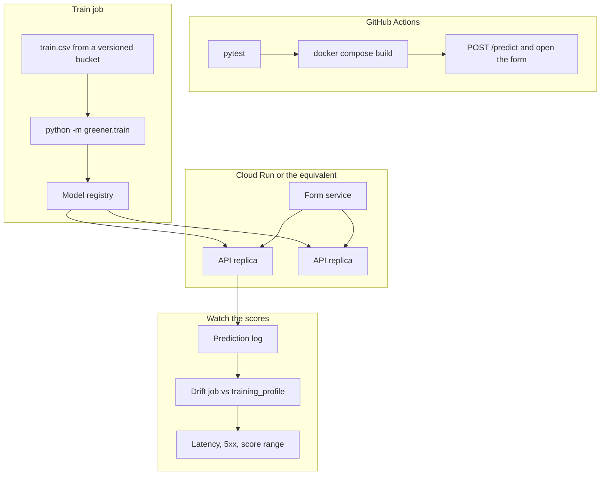
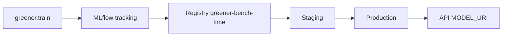
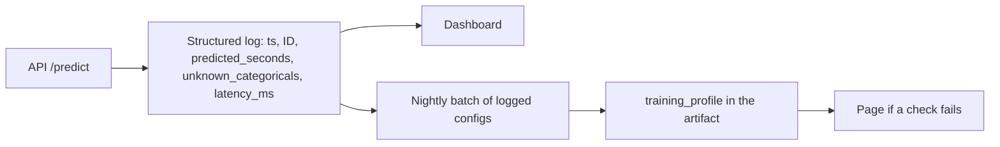

# Productionizing the test-bench model

The laptop setup in the README fits one model into a Docker image and serves it next to a form. This file is the path from that setup to something you can retrain, ship, and watch. Nothing here is wired up yet. The commands and field names match this repo.

What you already have:

- A stateless API (`greener/api.py`) and a stateless form (`frontend/app.py`). Either can be replicated.
- One artifact, `artifacts/model.joblib`, plus `artifacts/model.metadata.json`. The booster is JSON bytes inside the joblib, not a pickle of an XGBoost object.
- Pinned training libraries in `requirements.txt`. scikit-learn 1.7.2 and XGBoost 2.1.4 are part of the artifact. Bumping either one is a retrain.
- A training profile in the metadata: `y_mean`, `y_std`, `categorical_counts`, `binary_mean`, and the dropped columns.
- Request checks that already return 422: missing columns, non-binary flags, empty categories. Unseen category levels are scored as `-1` and listed in `unknown_categoricals`.
- In-sample metrics only. Early stopping in `greener/modeling.py` watches training R², because that is what the notebook did. Do not put 0.93 on a dashboard as generalization error.

## Target shape

Train offline. Promote an artifact by version. Serve the API and the form as separate services that only share `API_URL` and the model file. Log every score. Compare those logs to the training profile that shipped with the artifact.



The form stays a client. It does not load `model.joblib`. That split is already how `docker-compose.yml` works: `ui.API_URL=http://api:8000`.

## CI

Run the unit tests on every pull request, then build both images and hit the same endpoints `make docker-predict` hits. The dataset is in the repo today, so the runner does not need a Kaggle token until you stop committing the CSVs.

```yaml
# .github/workflows/test.yml
name: test
on:
  pull_request:
  push:
    branches: [master]
jobs:
  pytest:
    runs-on: ubuntu-latest
    steps:
      - uses: actions/checkout@v4
      - uses: actions/setup-python@v5
        with:
          python-version: "3.12"
      - run: pip install -e ".[dev]"
      - run: pytest
  images:
    runs-on: ubuntu-latest
    needs: pytest
    steps:
      - uses: actions/checkout@v4
      - run: docker compose build
      - run: docker compose up -d
      - run: |
          for i in $(seq 1 30); do
            curl -fsS http://127.0.0.1:8000/health && break
            sleep 2
          done
          curl -fsS http://127.0.0.1:8000/schema
          curl -fsS -X POST http://127.0.0.1:8000/predict \
            -H 'content-type: application/json' \
            --data @examples/known_request.json
          curl -fsS http://127.0.0.1:8501/_stcore/health
```

Gate the merge on both jobs. The image job is the one that fails when the Dockerfile and the package drift apart. Push the images to GHCR only from `master`, tagged with the git sha and with the model metadata field `trained_at`.

Do not train inside the request path, and stop training inside `docker build` once the artifact lives in a registry. The Dockerfile's `python -m greener.train` step is a convenience so `docker compose up` works on a laptop with only the CSV. In CI, build a runtime image that `COPY`s a promoted artifact and fails the build if `metadata.version` does not match the release.

## Experiment tracking and a model registry

Log one run per fit of `python -m greener.train`. The fields worth storing are already in the artifact metadata:

- Params: `max_depth` 4, `eta` 1, `objective` `reg:squarederror`, `seed` 0, `num_boost_round` 100, `early_stopping_rounds` 50, `pca_variance_requested` 0.99. They live in `greener/config.py`.
- Data: row count 4208 after the outlier drop, 12 dropped columns, 364 features, 36 components.
- Metrics: `train_rmse`, `train_r2`, and a holdout pair once you add one. Label the current pair `in_sample: true` so a registry UI cannot mistake them for a test score.
- Artifact: the joblib file and the metadata JSON.
- Library versions from `metadata.versions`.

MLflow is enough. A fit wrapper around `train_model` calls `mlflow.log_params`, `mlflow.log_metrics`, and `mlflow.log_artifact`. Register the run under a name such as `greener-bench-time`. Stages: `None` for a finished fit, `Staging` after the holdout bar, `Production` for the file the API is allowed to load.



Promotion rule to write down before the first prod model: holdout R² at least 0.8 and holdout RMSE under 8 seconds, on a split the early-stopping watchlist does not see. The current in-sample RMSE is about 3.3 seconds, so a holdout number near that is the interesting comparison, and a holdout number near the standard deviation of `y` (about 12.7 seconds before the outlier drop) means the model is not beating the mean by much.

The API should start by pulling `models:/greener-bench-time/Production` into `MODEL_PATH`, then serve that file. A failed download stays on the previous file and `/health` keeps reporting the `trained_at` it actually loaded. The health payload already returns `model_version`, `trained_at`, `n_features`, `n_components`, and `train_r2`.

Add the holdout split in `greener/modeling.py` before any registry work. Until that split exists, every promoted model is an in-sample fit with early stopping aimed at training R².

## Where to run it

The scored model is a PCA projection plus a small tree ensemble. CPU only. The artifact is a few hundred kilobytes. Memory is dominated by the Python process, not the booster. One vCPU and 1 GB is enough for the API. The form is the same order of magnitude. No GPU node, no Kubernetes cluster, until the request rate says otherwise.

Start with two Cloud Run services built from the Dockerfiles already in the repo. Build and push both images yourself so the UI image is `frontend/Dockerfile` and does not train a second model.

```bash
PROJECT=your-project
REGION=us-central1
SHA=$(git rev-parse --short HEAD)
REPO=$REGION-docker.pkg.dev/$PROJECT/greener

gcloud artifacts repositories create greener \
  --repository-format=docker --location=$REGION

docker build -t $REPO/api:$SHA .
docker build -f frontend/Dockerfile -t $REPO/ui:$SHA .
docker push $REPO/api:$SHA
docker push $REPO/ui:$SHA

gcloud run deploy greener-api \
  --image $REPO/api:$SHA \
  --region $REGION \
  --port 8000 \
  --cpu 1 --memory 1Gi \
  --min-instances 1 --max-instances 5 \
  --set-env-vars MODEL_PATH=/app/artifacts/model.joblib

gcloud run deploy greener-ui \
  --image $REPO/ui:$SHA \
  --region $REGION \
  --port 8501 \
  --cpu 1 --memory 1Gi \
  --min-instances 0 --max-instances 3 \
  --set-env-vars API_URL=https://greener-api-xxxxx.run.app
```

`min-instances 1` on the API keeps the first prediction from paying a cold start. The form can scale to zero. Set `API_URL` to the URL the API deploy prints.

The same split on the other clouds, still as two containers:

| Service | API | Form |
| --- | --- | --- |
| AWS | App Runner or ECS Fargate, port 8000, image from ECR | Second App Runner service, `API_URL` pointing at the API |
| Azure | Container Apps, ingress on 8000 | Container Apps, ingress on 8501, `API_URL` set to the API FQDN |

Put the images in that cloud's registry. Point both services at a specific digest, not `latest`. Roll the API forward by deploying a new revision that contains the promoted artifact, watch `/health` for the new `trained_at`, then send traffic. Cloud Run's traffic split, App Runner's pause, and Container Apps revisions all do that. Keep one previous revision for `gcloud run services update-traffic` (or the AWS/Azure equivalent) to send 100% back.

The Kaggle CSV does not belong in the runtime image once the artifact is promoted. Delete the `COPY train.csv` and `greener.train` lines from the runtime Dockerfile and copy the artifact in, or download it at startup from the registry URI.

## Monitoring and drift



Log one JSON line per prediction. Do not log the full 364-column body until you have a retention rule; log `ID`, `predicted_seconds`, `unknown_categoricals`, and the latency. Keep the full body in a restricted bucket if you want replay.

Page on:

- `/health` not 200, or `model_loaded` false.
- 5xx rate, and 422 rate. A jump in 422 means a client started omitting columns.
- Latency. This model should answer a single row in well under 100 ms on one vCPU, before network. Alert above 500 ms at p95 so you notice a stuck worker rather than the math.
- `predicted_seconds` outside 70–180. After the outlier drop, `training_profile` records `y_mean` 100.63 and `y_std` 12.42. The raw minimum in the file was 72.11. A score of 400 is a bad input or a bad artifact, not a slow car.
- Share of responses with a non-empty `unknown_categoricals`. The public test file has unseen levels in `X0`, `X2`, and `X5` (for example `X5 = t`). Some unknown codes are expected on that file. A sudden majority of production requests with unknown codes means the option list moved.

Drift, once a day, against `training_profile` in the metadata JSON:

- For each binary column, compare the batch mean to `binary_mean[column]`. Alert when the absolute gap exceeds 0.05. Those columns are 0/1, so 0.05 is a five-point swing in how often an option is fitted.
- For each categorical column, compare the batch's value counts to `categorical_counts[column]`. A chi-square or a population-stability bin on the top levels is enough. A level that is common in the batch and absent from `categorical_counts` is the same event as `unknown_categoricals`, counted on the batch instead of on one request.
- Compare the batch's `predicted_seconds` mean and std to `y_mean` and `y_std`. Alert when the mean moves by more than 5 seconds. That is large next to the in-sample RMSE of 3.288 seconds.

Retrain when a drift alert holds for a week, or when Mercedes adds an option code. Do not retrain on a single bad day.

## Data validation

The API already rejects a row that is missing a kept column, sends a flag other than 0 or 1, or sends a non-string category. That is the serving gate. Add a training gate in `greener/data.py` or `greener/preprocessing.py` that refuses to fit when:

- The file has a column other than `ID`, `y`, and `X*`.
- `y` is missing, non-numeric, or has more than a handful of rows at or above 200. One outlier is the notebook's finding. Fifty outliers is a different file.
- Any categorical column is all null.
- A binary column is not numeric.
- The row count is far from 4,209. A truncated download should not train.

Pandera or Great Expectations can express those checks. Run them in the train job before `train_model`, and fail the MLflow run if they fail.

Decide, in writing, what an unseen category should do in production. Today it scores as `-1` and the response names the column. That is the right behavior for a demo of test ID 1. For a line that must not guess, switch `/predict` to the preprocessor's `unknown="raise"` path and return 422. The encoder already supports that policy. The form's expander "Score a category the training set never saw" is the place that behavior shows up.

## Config and secrets

Environment variables this repo already reads:

| Variable | Process | Purpose |
| --- | --- | --- |
| `MODEL_PATH` | API | Artifact file. Default `artifacts/model.joblib`. |
| `GREENER_TRAIN_PATH` | Train | `train.csv` location. |
| `GREENER_TEST_PATH` | Train | `test.csv` location, only with `--predictions`. |
| `API_URL` | Form | Base URL of the API. |
| `EXAMPLES_DIR` | Form | Directory with `known_request.json` and `sample_request.json`. |
| `BANNER_PATH` | Form | Header image. Optional. |

No API key sits in the model. The only secret in the wider workflow is a Kaggle token, and only if training downloads the CSV instead of reading a bucket you control. Store `KAGGLE_USERNAME` and `KAGGLE_KEY` in GitHub Actions secrets or the cloud secret manager, inject them into the train job, and do not bake them into either image. `~/.kaggle/kaggle.json` on a laptop stays mode 600.

Move the env reads into a `pydantic-settings` object when the list grows past this table. Keep the names. `MODEL_PATH` is already the switch between a local file and whatever the start script downloaded.

The Docker image runs as uid 10001. Leave it that way. The artifact directory needs to be readable by that user and does not need to be writable after startup.

## Scaling

Scale the API horizontally. Each replica loads the same artifact. There is no session and no database in the request path.

- Run Uvicorn with more than one worker once a replica has more than one CPU: `uvicorn greener.api:app --host 0.0.0.0 --port 8000 --workers 2`. Two workers fit the 1 GB budget. The route is a plain `def`, so a single worker also uses a threadpool for the booster call.
- Put the load balancer in front of the API only. The form's `API_URL` should be that balancer, not a single pod IP.
- Scale the form on its own. Streamlit holds session state in the UI process, so sticky sessions matter if you run more than one UI replica. For this form the state is the widget values, and losing them on a refresh is acceptable. If it is not, one UI replica is enough: the heavy call is the API.
- Add `POST /predict/batch` when you need to score a whole shift, not one car. `Artifact.predict_dataframe` already scores a frame in one booster call. The CLI `--predictions` path uses it. A batch route should cap the body (a few thousand rows) and reuse the 422 rules per row or reject the whole body.
- Export to ONNX only if p95 latency becomes the problem. It is not the first bottleneck. Logging and a cold start will show up sooner.

Do not autoscale on CPU alone without a concurrency cap. A tree predict is short, so a concurrency of about 20 per vCPU is a reasonable Cloud Run setting to start from. Measure it with the batch of `test.csv` (4,209 rows) before picking a number to keep.

## Order of work

1. Add the GitHub Actions file above and require it on pull requests.
2. Hold out a validation slice in `greener/modeling.py`, point early stopping at it, and record both in-sample and holdout metrics. The notebook's watchlist is the reason this is first, not the registry.
3. Log fits to MLflow and promote with the holdout bar.
4. Change the runtime image so it receives a promoted artifact instead of training during `docker build`.
5. Deploy the two Cloud Run services (or App Runner, or Container Apps) from those images.
6. Log predictions and add the drift checks against `training_profile`.
7. Add the training-time schema checks, and decide whether unseen categories stay at `-1` or become a 422.
