<p align="center">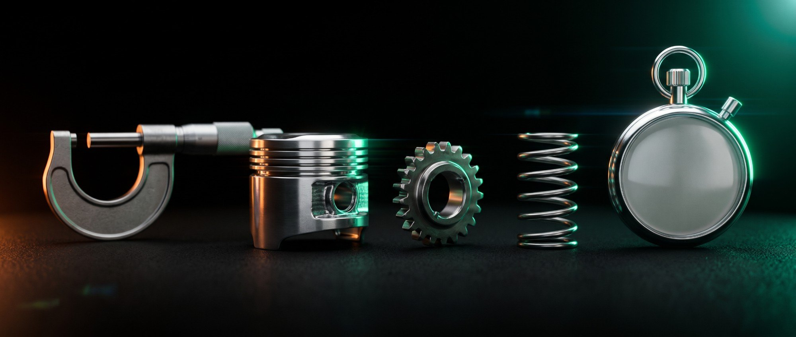</p>

# Mercedes-Benz Greener Manufacturing

Every car on this line is a different pile of options. The test bench has to try each one, and the time that takes is the column `y` in the Kaggle file: seconds. This project predicts that number from the configuration, so planning does not have to wait for the bench.

The exploration that found the outlier, the zero-variance columns, and the XGBoost fit is still in `Mercedes Benz Greener.ipynb`. The runnable version is a Python package, a training command, a FastAPI service, and a Streamlit form. Docker runs the last two together.

## Run it

### Docker, API and form together

From the repo root, with Docker running:

```bash
docker compose up --build
```

The first build installs the wheels and fits the model into the API image. After that:

- Form: http://127.0.0.1:8501
- API docs: http://127.0.0.1:8000/docs
- Health: http://127.0.0.1:8000/health

`make docker-up` is the same compose command in the background. `make docker-predict` checks health and posts `examples/known_request.json`. `make docker-down` stops the stack.

## Demo

With the compose stack up, the walkthrough is:

1. Open http://127.0.0.1:8501. The form starts on test ID 5 (`X0` is `w`, `X5` is `y`). The sidebar should say the model is loaded: 364 features, 36 principal components, in-sample R² 0.930.
2. Press **Predict bench time**. The card reads **110.85s** for ID 5, 10.2s slower than the training average of 100.6s.
3. Press **Load test ID 1 (X5 never seen in training)**, then **Predict bench time** again. The card reads **76.67s**. The amber note says `X5` did not appear in training and was encoded as the shared unknown code (`-1`).
4. Open http://127.0.0.1:8000/health. The body is JSON with `"status": "ok"` and `"model_loaded": true`.
5. Open http://127.0.0.1:8000/docs. The page lists `GET /health`, `GET /schema`, and `POST /predict`.

### Python on your machine

```bash
python3 -m venv .venv
source .venv/bin/activate
make install
make train
make test
```

`make train` writes `artifacts/model.joblib` and `artifacts/model.metadata.json`. Then, in two terminals:

```bash
make serve   # http://127.0.0.1:8000
make ui      # http://127.0.0.1:8501
```

Score the known example without the form:

```bash
make predict
```

Or with curl:

```bash
curl -sS -X POST http://127.0.0.1:8000/predict \
  -H 'content-type: application/json' \
  --data @examples/known_request.json
```

`GET /schema` lists the columns and the category levels the form uses. A full row shaped like `test.csv` is also a valid `POST /predict` body. `examples/sample_request.json` is the first test row.

## What is running

The browser only talks to Streamlit. Streamlit asks the API for the schema, then posts one configuration. The API loads the artifact once at startup and keeps the booster in memory.

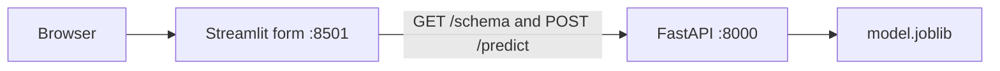

`docker compose` runs those as two services. The API image trains during `docker build`, so the container starts with a model already on disk at `/app/artifacts/model.joblib`. The UI image has no model. It reads `API_URL`, which compose sets to `http://api:8000`.

## How the model is built

`python -m greener.train` reads `train.csv` and writes the artifact. The steps follow the notebook, in the same order.

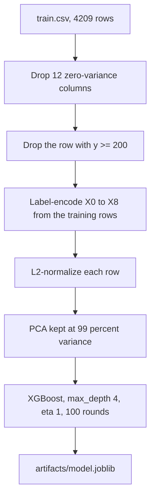

1. `greener/data.py` finds `train.csv`. The search is the `--train` path, then `GREENER_TRAIN_PATH`, then `./train.csv`, then `./data/train.csv`, then the file next to the checkout. A missing file exits with the Kaggle download steps.
2. `greener/preprocessing.py` measures standard deviation on the full training file, before the outlier is removed, and drops columns whose std is 0. On this file that is `X11`, `X93`, `X107`, `X233`, `X235`, `X268`, `X289`, `X290`, `X293`, `X297`, `X330`, `X347`. It then drops the one row with `y >= 200` (the car at 265.32 seconds). 4,208 rows and 364 features remain.
3. The eight categorical columns are label-encoded from those training rows. Classes are sorted, same as scikit-learn's `LabelEncoder`. A level that shows up later is stored as `-1`, one shared unknown bucket.
4. `Normalizer` scales each row to unit L2 norm. `PCA(n_components=0.99)` keeps 36 components.
5. `greener/modeling.py` fits XGBoost with the notebook's depth and learning rate. The objective is `reg:squarederror`. The notebook passed `reg:linear`, which was an alias and current XGBoost rejects it. Early stopping watches in-sample R², because the notebook's watchlist was the training matrix only. `seed` is 0 so a rebuild does not wander.
6. The artifact stores the preprocessor, the booster as its own JSON bytes, and metadata: in-sample RMSE and R², the column lists, category counts, and the mean of each binary flag. A sibling `*.metadata.json` is there so you can read the profile without unpickling.

On the pinned stack in `requirements.txt` the in-sample fit is R² 0.9299 and RMSE 3.288 seconds. `make train` prints that pair. The notebook reported R² 0.9341 and RMSE 3.19 on an older XGBoost. Both numbers are in-sample. Neither is a holdout score.

To also score `test.csv` the way the notebook wrote `model.csv`:

```bash
python -m greener.train --predictions artifacts/test_predictions.csv
```

That CSV has `ID` and `predicted_seconds`. It will not match `model.csv` cell for cell. The notebook refit a separate label encoder on the test file, so a category's integer in training was not that category's integer in the submission. A live car does not come with the rest of the test file, so the packaged model cannot do that.

## How one prediction is scored

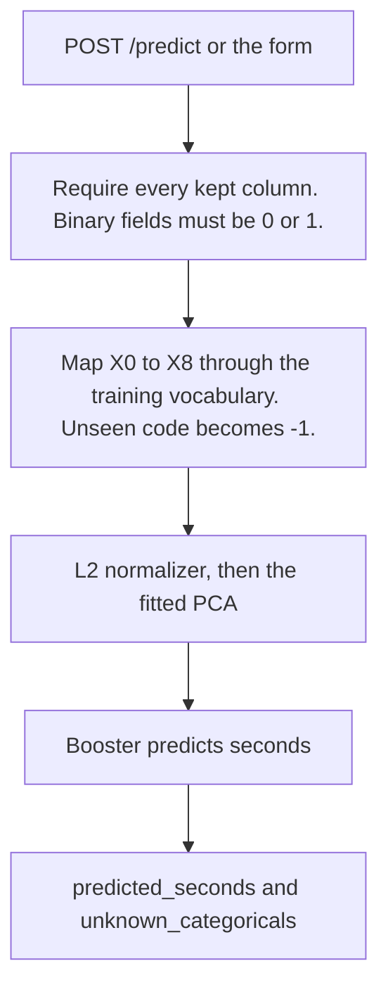

`GET /health` returns `ok` when the artifact loaded, and `503` with `model_loaded: false` when `MODEL_PATH` is missing or unreadable. `GET /schema` returns the column lists, the allowed category levels, and the training mean of `y` (100.63 seconds after the outlier is removed). The form builds its dropdowns from `/schema`, so a retrained artifact does not need a UI change.

Constant columns may be present in the JSON and are ignored. Any other unknown field is reported back if a required column is also missing.

## Data

`train.csv` and `test.csv` are already at the repo root. They are the files from the Kaggle competition [Mercedes-Benz Greener Manufacturing](https://www.kaggle.com/competitions/mercedes-benz-greener-manufacturing/data).

- `train.csv`: 4,209 rows, 378 columns. `ID`, the target `y` (seconds), categorical `X0`–`X8`, and binary option flags.
- `test.csv`: 4,209 rows, 377 columns. Same features, no `y`.

If a checkout does not have them:

```bash
pip install kaggle
# ~/.kaggle/kaggle.json must be mode 600, and the competition rules must be accepted.
kaggle competitions download -c mercedes-benz-greener-manufacturing
unzip mercedes-benz-greener-manufacturing.zip
```

Point the trainer at another directory with `--train` / `--test`, or with `GREENER_TRAIN_PATH` and `GREENER_TEST_PATH`. The API reads the fitted file from `MODEL_PATH` (default `artifacts/model.joblib`).

## Layout

| Path | Role |
| --- | --- |
| `Mercedes Benz Greener.ipynb` | Original exploration. Left as it was. |
| `greener/data.py` | Find and load the CSVs. |
| `greener/preprocessing.py` | Zero-variance drop, outlier drop, label encoding, normalizer, PCA. |
| `greener/modeling.py` | Fit XGBoost, save and load the artifact, score a row. |
| `greener/train.py` | `python -m greener.train` |
| `greener/api.py` | `/health`, `/schema`, `/predict` |
| `frontend/app.py` | Streamlit form |
| `examples/known_request.json` | Test ID 5, all categories seen in training |
| `examples/sample_request.json` | Test ID 1, unseen `X5` |
| `Dockerfile` | API image. Trains during the build. |
| `frontend/Dockerfile` | UI image. |
| `docker-compose.yml` | Both services. |
| `Makefile` | The commands above. |
| `PRODUCTIONIZING.md` | What to add before this leaves a laptop. |

## Tests

```bash
make test
```

The tests check the twelve dropped columns, the single outlier, 36 principal components, an in-sample R² above 0.9, artifact reload, the CLI's missing-file message, `/health`, `/schema`, `/predict`, and that the form's record scores the same seconds as the raw sample.

## The original study

Mercedes-Benz has a wide option list, and every combination still has to clear the bench. The notebook's question was whether the configuration alone can predict that time.

Train shape in the study: 4,209 rows, 378 columns. Test shape: 4,209 rows, 377 columns. `y` runs from 72.11 to 265.32 seconds, mean 100.67, standard deviation 12.68. One car sits above 200 seconds. The plots below are the ones the notebook saved.


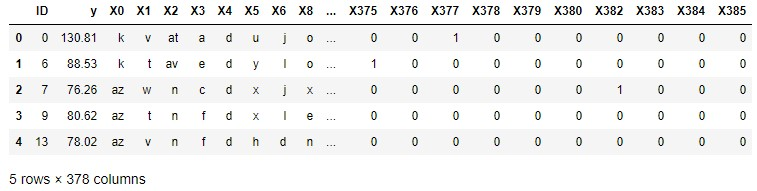

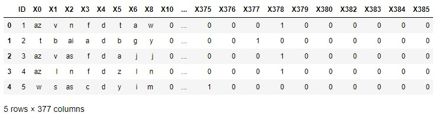

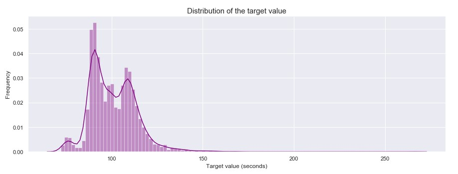

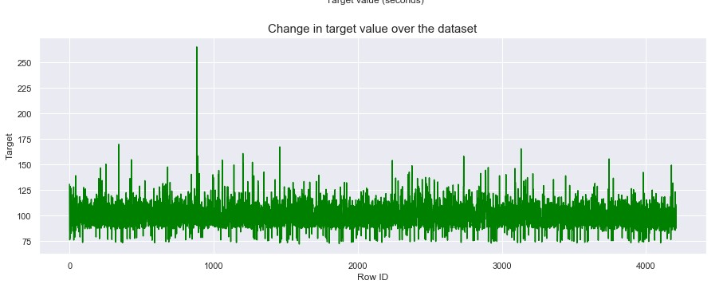

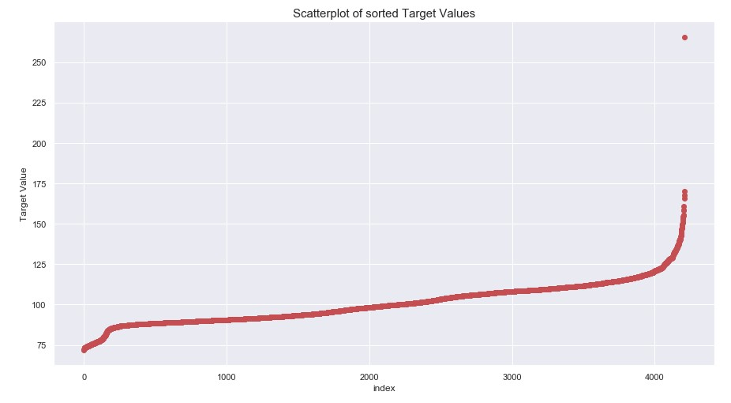

The categorical columns have too many levels for a one-hot encoding of this width, so the notebook used a label encoder, then a normalizer, then PCA, then XGBoost. The packaged pipeline is that sequence, with the encoder fit on the training rows only so a single car can be scored.

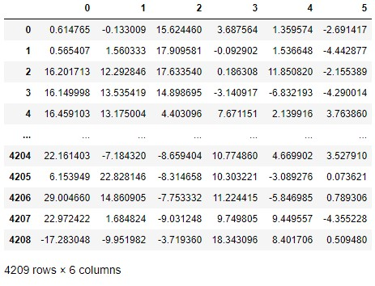

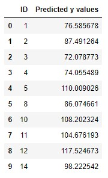
